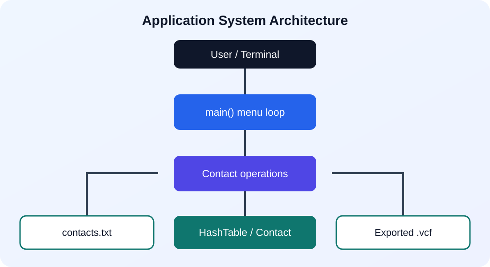

  

  # 📇 Contact Searching Application

  **A C++ command-line contact manager built around a custom hash-table implementation.**

  Manage contacts, search by name or phone number, find partial name matches, update records, and export individual contacts as vCard files.

  
  
  
  

  [📖 Documentation](docs/README.md) · [🐛 Report a bug](https://github.com/Brajesh31/Contact-Searching-Application/issues/new?template=bug_report.yml) · [💡 Request a feature](https://github.com/Brajesh31/Contact-Searching-Application/issues/new?template=feature_request.yml)

---

## ✨ Overview

Contact Searching Application is a terminal-based address-book program written in C++. It loads comma-separated contact records from contacts.txt into an in-memory custom hash-table structure and provides a menu for maintaining and searching those records.

This documentation describes the existing implementation. It is not a web application, does not expose an HTTP API, and does not use a database server.

## 🖼️ Project identity and preview

The application is interactive in a terminal. No GUI screenshots are included because the repository does not contain a graphical interface or verified screenshot capture. See the [user guide](docs/user-guide.md) for the actual menu and operations.

## 🚀 Features

| Capability | Current behavior |
|---|---|
| ➕ Add | Prompts for name, 10-character phone number, and email; checks duplicate phone numbers |
| 🔎 Exact search | Scans contacts for an exact name or phone-number match |
| 🔤 Partial-name search | Case-insensitive substring matching against names |
| 📝 Modify | Finds by exact name or phone number, then prompts for replacement fields |
| 🗑️ Delete | Deletes the first matching phone number |
| 📋 List | Displays all contacts sorted by name |
| 📤 Export | Writes one selected contact as a vCard 3.0 .vcf file |
| 💾 Persistence | Rewrites contacts.txt after each completed menu operation |

> **Search terminology:** the menu calls option 6 “Fuzzy Search”, but the implementation performs case-insensitive substring matching. It does not calculate edit distance or correct arbitrary spelling mistakes.

## 🧰 Technology and implementation

- **Language:** C++.
- **Compiler mode:** GNU++17 is declared in the existing VS Code workspace configuration.
- **Header:** the source includes the GNU convenience header bits/stdc++.h.
- **Data structure:** a custom HashTable wrapper with vector<Contact> buckets.
- **Collision handling:** linear probing across buckets.
- **Growth:** the rehash routine doubles the bucket-array size after the load-factor check.
- **Persistence:** a local comma-delimited contacts.txt file.
- **Export:** vCard 3.0 text file.
- **Editor metadata:** existing VS Code and JetBrains files are preserved.

A GCC-compatible toolchain is the most direct build environment because bits/stdc++.h is not part of ISO C++.

## 🏗️ Architecture

At startup, main() allocates the hash table and reads contacts.txt. Menu choices dispatch to the contact operations. Non-exit menu iterations rewrite the contact file from the current in-memory table.

### Main source responsibilities

| Source element | Responsibility |
|---|---|
| Contact | Holds name, phoneNumber, and email |
| HashTable | Holds bucket count and dynamically allocated bucket array |
| insertContact() | Inserts a contact, checks load factor, and may trigger rehashing |
| rehash() | Allocates a larger bucket array and reinserts existing entries |
| contactExists() | Checks an exact name or phone-number match |
| getContact() | Returns a matching contact or an empty contact |
| deleteContact() | Removes a contact by phone number |
| Search() | Prints exact name or phone-number matches |
| fuzzySearch() | Performs case-insensitive substring matching on names |
| modify() | Updates fields for a matching contact |
| display() | Collects and sorts contacts by name before printing |
| exportToVCF() | Writes a vCard 3.0 file |
| main() | Initializes storage, loads data, dispatches the menu, and persists records |

## 📂 Repository structure

~~~text
Contact-Searching-Application/
├── .github/
│   ├── ISSUE_TEMPLATE/
│   ├── workflows/
│   ├── dependabot.yml
│   └── PULL_REQUEST_TEMPLATE.md
├── docs/
│   ├── architecture/
│   ├── accessibility/
│   ├── assets/
│   ├── development/
│   ├── deployment/
│   ├── maintenance/
│   ├── operations/
│   ├── privacy/
│   ├── product/
│   ├── security/
│   ├── templates/
│   └── testing/
├── scripts/
├── tests/
├── main.cpp
├── contacts.txt
├── Dummy Contacts.txt
├── LICENSE
├── README.md
└── ...
~~~

See the [audited project structure](docs/project-structure.md) for the important original and supporting files.

## ⚙️ Getting started

### Prerequisites

- A C++ compiler with GNU C++17 support, such as GCC.
- A terminal or command prompt.
- Git, if cloning the repository.

### 1. Clone

~~~bash
git clone https://github.com/Brajesh31/Contact-Searching-Application.git
cd Contact-Searching-Application
~~~

### 2. Compile

~~~bash
g++ -std=gnu++17 -Wall -Wextra -Wpedantic main.cpp -o contact-search
~~~

### 3. Run

Linux/macOS:

~~~bash
./contact-search
~~~

Windows PowerShell:

~~~powershell
.\contact-search.exe
~~~

Run the executable from the repository directory so the relative contacts.txt path resolves to the tracked sample data file.

## 🕹️ Menu

| Choice | Operation |
|---:|---|
| 1 | Add a contact |
| 2 | Delete a contact |
| 3 | Export contact to VCF |
| 4 | Display contacts |
| 5 | Search contact |
| 6 | Fuzzy/partial-name search |
| 7 | Modify contact |
| 8 | Exit |

See the [user guide](docs/user-guide.md) for operation details and the [data format guide](docs/data-format.md) for file structure.

## 🧪 Validation and testing

Compile and run the integration smoke test using a temporary directory and synthetic records:

~~~bash
g++ -std=gnu++17 -Wall -Wextra -Wpedantic main.cpp -o contact-search
python3 tests/test_cli_smoke.py ./contact-search
~~~

The smoke test exercises contact loading, adding, exact search, case-insensitive partial-name search, data-file persistence, and vCard export. It does not modify the repository's tracked contacts.txt.

Repository documentation and preservation checks:

~~~bash
python3 scripts/validate_docs.py
python3 scripts/validate_svg.py
python3 scripts/validate_mermaid.py
python3 scripts/check_license.py
python3 scripts/repository_audit.py
~~~

These checks validate documentation/support infrastructure and protected-file integrity. They do not imply exhaustive application test coverage.

## ⚠️ Known limitations

- The application expects contacts.txt in its current working directory.
- The contact file is comma-separated and has no escaping mechanism for commas in fields.
- Phone-number validation on add checks length only.
- Modify does not repeat the add path's phone validation or duplicate check.
- Partial search is not edit-distance fuzzy matching.
- Several operations scan every bucket, so lookup is not consistently constant-time.
- Hash-table storage uses manual dynamic allocation.
- File persistence rewrites the whole data file and is not transactional.
- The automated smoke test covers only a narrow set of real CLI workflows; delete, modify, malformed data, and error paths remain manually documented or untested.

Use a disposable copy of the repository for experiments. Do not store real personal contact details in a public repository.

## 🔐 Security and privacy

Contact data is personal information. Use synthetic records in demonstrations, keep personal contact files outside version control, and review [SECURITY.md](SECURITY.md) and [data protection guidance](docs/security/data-protection.md).

## 📚 Documentation index

- [Documentation home](docs/README.md)
- [Product overview and requirements](docs/product/README.md)
- [User guide](docs/user-guide.md)
- [Getting started](docs/getting-started.md)
- [Architecture and diagrams](docs/architecture/README.md)
- [Data flow and data dictionary](docs/data-flow.md)
- [Data format](docs/data-format.md)
- [Configuration and dependencies](docs/configuration.md)
- [Development guide](docs/development/README.md)
- [Testing and QA](docs/testing/README.md)
- [Automated CLI smoke tests](tests/README.md)
- [Security and privacy](docs/security.md)
- [Accessibility review](docs/accessibility/README.md)
- [Deployment and operations](docs/deployment/README.md)
- [Maintenance and risk register](docs/maintenance/README.md)
- [Checklist coverage](docs/checklist-coverage.md)
- [Troubleshooting](docs/troubleshooting.md)
- [Changelog](CHANGELOG.md)
- [Roadmap](ROADMAP.md)

---

  **Built with C++ for learning contact management and hash-table concepts.**

  [Back to top](#-contact-searching-application)

