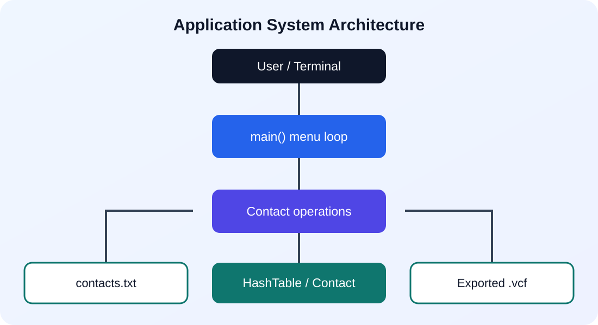

# 🏗️ Architecture

## System shape

The inspected application is a single-process C++ command-line program. Its primary implementation is in `main.cpp`. It has no network or database layer.

Editable source: [system-architecture.mmd](architecture/system-architecture.mmd)

## Runtime components

| Component | Implementation | Responsibility |
|---|---|---|
| Contact model | `Contact` | Three string properties |
| Table container | `HashTable` | Bucket count and dynamically allocated bucket array |
| Bucket | `vector<Contact>` | Stores contact records in a bucket |
| Input/menu | `main()` | Reads menu choices and fields |
| Persistence | `ifstream` / `ofstream` | Loads and rewrites `contacts.txt` |
| Search/operations | Free functions | Add, find, update, delete, list, and export |
| VCF exporter | `exportToVCF()` | Emits a vCard 3.0 text file |

## Data structure and insertion

The table begins with 10 buckets. The insertion routine derives an initial index from the contact name length modulo the table size. If that bucket is occupied, it advances through buckets using linear probing. Each bucket itself is a vector.

When the calculated load factor exceeds 0.75, the rehash routine doubles the table size and reinserts records.

## Search characteristics

The exact search, contact existence checks, retrieval, deletion, display, and partial-name search scan across buckets. Therefore, do not infer constant-time behavior for every operation from the presence of a hash table.

## Persistence boundary

The in-memory table is initialized from `contacts.txt`. The application rewrites the file after processing each non-exit menu choice. There is no separate repository, database abstraction, transaction system, or backup mechanism in the current source.

## Trust boundaries

All terminal input and file contents should be treated as untrusted. The current implementation has limited validation. This document records the architecture; it does not certify that these boundaries are fully enforced.
