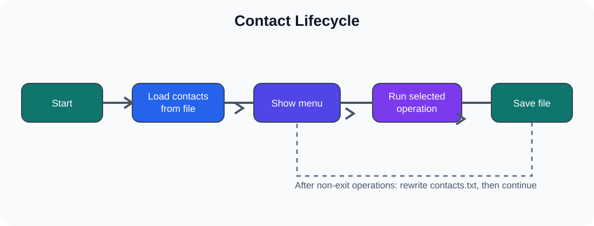

# 🔄 Data Flow

## Startup

1. The process creates a hash-table wrapper.
2. It allocates the initial bucket array.
3. It opens `contacts.txt`.
4. Each input line is split into name, phone number, and email.
5. Parsed records are inserted into the in-memory structure.

## Menu operation

1. The program prints the menu.
2. The user enters a menu number.
3. The selected operation reads additional input where needed.
4. The operation changes or reads the in-memory contacts.
5. For non-exit operations, the application rewrites `contacts.txt` from the current table.

Editable diagram: [contact-lifecycle.mmd](architecture/contact-lifecycle.mmd)

## Export path

The selected record is retrieved from the table. The exporter opens a name-derived `.vcf` file and writes vCard 3.0 fields.

## Important behavior

The application does not provide atomic file replacement or transactional persistence. A write failure or interruption may leave data incomplete. Work with backups and disposable data.
